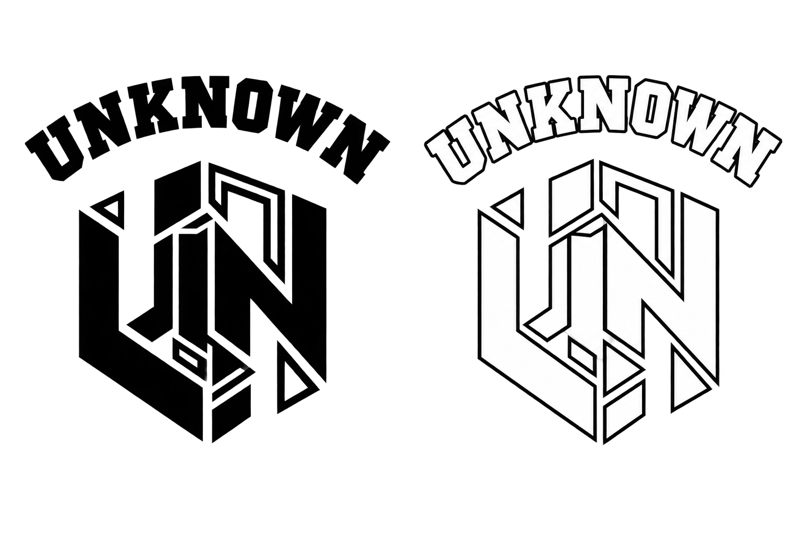

<p align="center">
  
</p>

<h1 align="center">UNKNOWN Beginner CTF</h1>

<p align="center">
  초보자들이 CTF에 재미를 붙일 수 있도록 만든 입문용 CTF 플랫폼입니다.
</p>

## 🎯 프로젝트 소개

CTF를 처음 접하는 사람들을 위한 Beginner CTF입니다. Dreamhack이나 일반 워게임을 많이 풀어보지 않은 참가자도 도전할 수 있는 난이도를 목표로 문제와 플랫폼을 함께 준비했습니다.

[CTFd](https://ctfd.io/)를 베이스로, Challenges 페이지와 Scoreboard 페이지를 UNKNOWN 전용 다크 테마로 새로 구성했습니다.

## 🚩 Flag Format

```
UNKNOWN{example_flag}
```

## 🧩 Categories

- Web
- Pwn
- Reversing
- Crypto
- OSINT
- Misc

## ✨ Features

- 초보자 친화적인 난이도로 구성된 Challenge
- Category 기반 Challenge 구성 (Web / Pwn / Reversing / Crypto / OSINT / Misc)
- Overview Scoreboard — 순위 / 팀 / 점수 / 푼 문제 수
- Detailed Scoreboard — 팀 × Challenge 매트릭스, Category별 그룹핑
- Challenge별 Solve 현황 및 First Blood 표시
- 팀 클릭 시 팀별 상세 정보(순위/점수/solve 현황) 확인
- UNKNOWN 전용 Dark CTF UI (Challenges / Scoreboard / Navbar / Footer 공통 디자인 시스템)

## 🛠 Tech Stack

- [CTFd](https://ctfd.io/) (Flask 기반 CTF 프레임워크)
- MariaDB
- Redis
- Nginx
- Docker / Docker Compose

## 🚀 Running

이 저장소의 `docker-compose.yml` 기준 실행 방법입니다.

```bash
docker compose up -d --build
```

실행 후 기본적으로 아래 주소로 접속할 수 있습니다. (환경에 따라 접속 주소는 달라질 수 있습니다.)

- Nginx 경유: http://localhost
- CTFd 직접 접속: http://localhost:8000

종료할 때는 다음 명령을 사용합니다.

```bash
docker compose down
```

## 📁 Structure

```
.
├── CTFd/                    # CTFd 본체 (플랫폼 코드)
│   └── themes/
│       ├── core/            # 기본 테마 + UNKNOWN 공통 스타일(navbar, footer, background 등)
│       └── unknown/         # UNKNOWN 전용 Challenges / Scoreboard 테마
├── challenges/              # 카테고리별 챌린지 소스 (web / pwn / reversing / crypto / osint / misc)
├── scripts/                 # 챌린지 시딩 / 테마 활성화 / 검증용 스크립트
├── conf/                    # Nginx 설정
├── docker-compose.yml       # 플랫폼 실행 구성 (ctfd, nginx, db, cache)
└── Dockerfile
```

## 📜 License

이 프로젝트는 [CTFd](https://github.com/CTFd/CTFd)를 기반으로 하며, CTFd와 동일하게 [Apache License 2.0](LICENSE)을 따릅니다.

- Original project: [CTFd](https://github.com/CTFd/CTFd) (Copyright CTFd LLC)
- Logo by [Laura Barbera](http://www.laurabb.com/), Theme by [Christopher Thompson](https://github.com/breadchris) — CTFd 기본 크레딧
